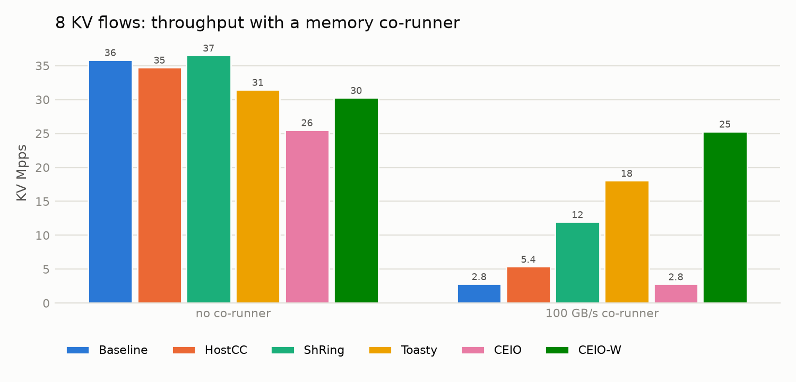
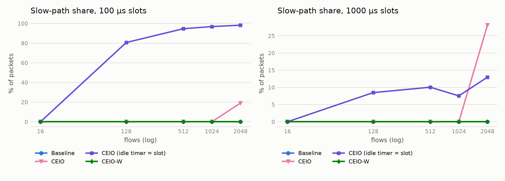
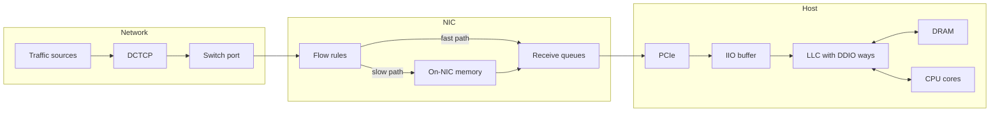

# CEIO-W

This repo has two things in it. The first is a simulator of the receive path
of a server, from the NIC through PCIe and the CPU's last-level cache (LLC)
down to DRAM. The second is CEIO-W, a small extension to CEIO (SIGCOMM 2025)
that borrows the main idea from Toasty (ASPLOS 2026).

## Background

NICs today write incoming packets straight into the LLC (Intel calls this
DDIO), so the CPU can read them without going to DRAM. This only works while
the packets fit in the few cache ways DDIO is allowed to use. Two things go
wrong when they don't:

- New packets push older ones out of the cache before the CPU gets to them,
  so the CPU ends up reading them from DRAM anyway ("leaky DMA").
- Buffers the application has already finished with are still dirty in the
  cache, so they get written back to DRAM even though nobody needs that data
  ("dead writebacks").

CEIO deals with the first problem. It gives every flow a number of credits
sized to the LLC, and once a flow runs out, its packets wait in the NIC's own
memory instead of flooding the cache. Toasty deals with the second. It hands
out the most recently freed buffer first, because that buffer is probably
still in the cache.

CEIO-W puts the two together. In CEIO a credit only counts how many packets
are in flight, not which buffers they land in. A FIFO buffer pool can still
cycle through thousands of different buffers, which spreads the traffic over
far more cache than the credits suggest. In CEIO-W a credit is an actual
buffer posted to the NIC, and freed buffers are reused warm, so the limit
applies to the cache footprint itself.

## Results in short

All numbers come from the simulator, not from hardware.

| | CEIO | CEIO-W |
|---|---|---|
| Different buffers used by one KV core below capacity | 8,192 | 20 |
| PCIe write hit rate in that run | 0.10 | 0.99 |
| Dead writebacks in the dynamic-flow scenario | 455 K | 25 K |
| Goodput of an overloaded KV core | 16.2 Gbps | 23.9 Gbps |
| 8 KV flows next to a 100 GB/s memory-heavy program | 2.8 Mpps | 25.3 Mpps |
| Packets on the slow path with 2048 flows coming and going | up to 98 % | 0 % |

Neither design drops or reorders packets in any of the experiments.

<p align="center">
  
  
</p>

CEIO-W is not better everywhere. When memory isn't under pressure, ShRing and
Toasty match it or beat it in several of the scenarios. The full set of
results, including those cases, is in [docs/results.md](docs/results.md).

## How CEIO-W works

It changes four things in CEIO:

1. **The ring is the credit pool.** The driver never posts more buffers to a
   receive queue than that queue's credit target. A credit is a buffer that
   is either posted or holding a packet the application hasn't finished. When
   the ring runs empty the NIC sends the flow's packets to its own memory, the
   same way CEIO does when credits run out. CEIO's NIC has to poll counters to
   notice this, and flows can overshoot in the meantime. Here the NIC notices
   right away.
2. **Warm buffers.** Freed buffers go back on a stack (LIFO), and replies are
   sent as soon as they are ready, so recently used buffers come back quickly.
   This is taken from Toasty.
3. **Credits follow demand.** Each queue's target is ten times the number of
   packets it handled in a recent batch, which is Toasty's estimate for how
   many buffers a queue needs. Targets are scaled down when their sum goes
   over a global budget. RDMA flows get a small fixed cap, since the CPU never
   reads their data.
4. **The budget adjusts itself.** The host checks its own LLC miss counters.
   If misses climb, the budget shrinks; otherwise it slowly grows back.

Credits are kept per receive queue, not per flow, so the bookkeeping grows
with the number of cores rather than the number of flows. All of it runs in
the host driver. [docs/ceio-w.md](docs/ceio-w.md) has the details.

## What is in the simulator



| Directory | What's there |
|---|---|
| `include/ceio/sim` | Event scheduler, time units, random numbers, statistics |
| `include/ceio/hw` | LLC with DDIO ways, DRAM, PCIe and the IIO buffer |
| `include/ceio/net` | Traffic patterns, the switch port, DCTCP |
| `include/ceio/nic` | Flow rules, receive queues (normal and RDMA), DMA |
| `include/ceio/host` | Buffer pools, CPU cores and the driver, application models |
| `include/ceio/policy` | CEIO, CEIO-W and HostCC |
| `include/ceio/exp` | Scenarios, the paper setups, the experiment runner |
| `tools/ceio_run.cpp` | Command-line tool that runs one scenario and prints JSON |
| `python/ceiosim` | Scripts that run all experiments and draw the figures |

A few things about the model that matter for the results:

- The cache is tracked one 64-byte line at a time and every buffer has a real
  address, so which buffer gets reused actually changes the outcome.
- Leaky-DMA evictions and dead writebacks are counted directly.
- A run with the same seed always gives exactly the same result.

## Building and running

You need CMake 3.24 or newer, Ninja, and a C++20 compiler (Clang 16+ or GCC
12+). Python 3.10+ with matplotlib is only needed for the experiment scripts.
GoogleTest is downloaded during the build.

```bash
git clone https://github.com/neel685/ceio-w.git && cd ceio-w
cmake --preset release && cmake --build --preset release
ctest --preset release
```

There are also `dev` (debug) and `asan` (sanitizers) presets, and
`make test-all` runs the debug, release and UBSan builds.

`ceio_run` runs one scenario. Some examples:

```bash
# CEIO-W and CEIO on an overloaded key-value core
build/release/ceio_run --testbed=ceio --app=kv --pkt=512 --rate=26 --pool=8192 --ring=4096 --scheme=ceio-w
build/release/ceio_run --testbed=ceio --app=kv --pkt=512 --rate=26 --pool=8192 --ring=4096 --scheme=ceio

# The setups from the CEIO paper; --scheme can be baseline, hostcc, shring, toasty, ceio or ceio-w
build/release/ceio_run --preset=dynamic --scheme=ceio-w
build/release/ceio_run --preset=mixed --cpu-flows=8 --pressure=100 --scheme=toasty
build/release/ceio_run --preset=churn --flows=2048 --slot-us=100 --scheme=ceio

# Highest NAT throughput with Toasty before more than 0.1% of packets are lost
build/release/ceio_run --testbed=toasty --app=nat --toasty=full --saturate=0.001
```

Run `ceio_run --help` for the full list of options. To switch off parts of
CEIO-W, use `--w-equal=1` (split credits evenly), `--w-static=1` (keep the
budget fixed) or `--w-budget=F` (start the budget at fraction F). To give
plain CEIO a LIFO pool, use `--scheme=ceio --warm=1`.

## Reproducing the results

This builds everything, runs the tests, and regenerates every table and figure:

```bash
scripts/reproduce.sh            # full run, a few minutes
scripts/reproduce.sh --quick    # smaller sweeps, about a minute
```

Tables end up in [docs/generated/RESULTS.md](docs/generated/RESULTS.md) (and
as CSV next to it) and figures in `docs/figures/`. The quick run writes to
`docs/generated/quick/` so it doesn't overwrite the published figures.

Results are cached, so running the script again only re-simulates what
changed. The cache is tied to the simulator binary, so rebuilding it starts
fresh. You can also run a subset:

```bash
.venv/bin/python -m ceiosim --list
.venv/bin/python -m ceiosim --only footprint,flow_churn
```

The same thing works in Docker:

```bash
docker build -t ceio-w .
docker run --rm -v "$PWD/docs:/ceio-sim/docs" ceio-w
```

## Tests

There are 155 C++ tests and 10 tests for the Python scripts. Besides normal
unit tests, they check that known effects show up on their own in the model
(leaky DMA, dead writebacks, drops under bursts), that every reproduced claim
from the CEIO and Toasty papers holds, and that CEIO-W behaves as described.
They pass with both GCC and Clang.

## Documentation

- [docs/ceio-w.md](docs/ceio-w.md) explains the CEIO-W design.
- [docs/results.md](docs/results.md) goes through the reproduction of Toasty
  and CEIO and the CEIO-W evaluation.
- [docs/spec.md](docs/spec.md) lists every parameter in the model, where each
  value comes from, and what the model leaves out.

## Limitations

- Everything here is simulated. The model has no private L2 cache or hardware
  prefetcher, so it underestimates how much a cache miss costs in throughput.
  Results about cache footprint and memory traffic are more reliable than
  absolute throughput numbers.
- CEIO's own mechanisms behave as the paper describes, but its headline
  speedups over the baseline don't show up in this model.
  [docs/results.md](docs/results.md) discusses why.
- CEIO-W assumes the NIC can send a packet to its own memory when a receive
  ring is empty, instead of dropping it. That hasn't been tried on real
  hardware.

## References

- B. Liu et al. CEIO: A Cache-Efficient Network I/O Architecture for NIC-CPU
  Data Paths. SIGCOMM 2025.
- Preeti, N. Bhat, A. Kumar, M. Vutukuru. Toasty: Speeding Up Network I/O
  with Cache-Warm Buffers. ASPLOS 2026.
- S. Agarwal, A. Krishnamurthy, R. Agarwal. Host Congestion Control.
  SIGCOMM 2023.
- B. Pismenny et al. ShRing: Networking with Shared Receive Rings. OSDI 2023.
