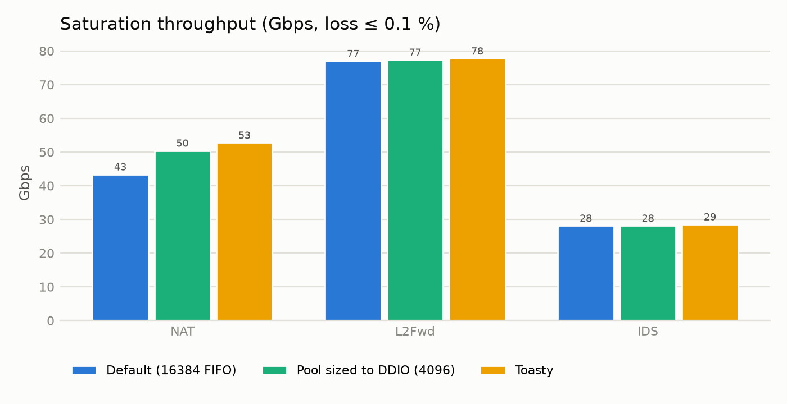
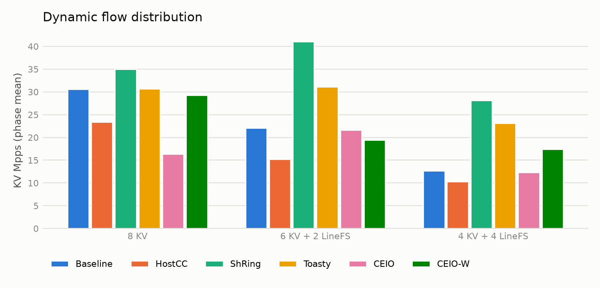
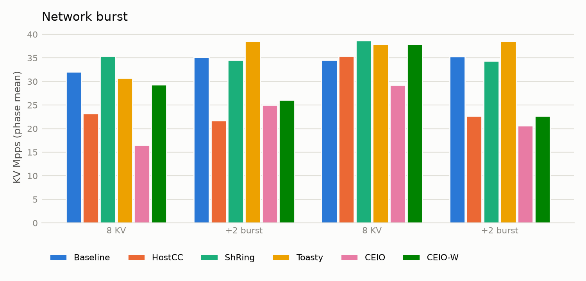
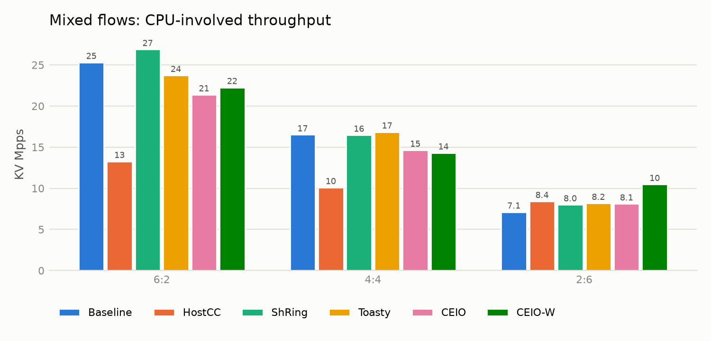
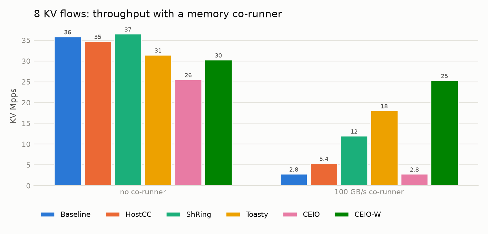
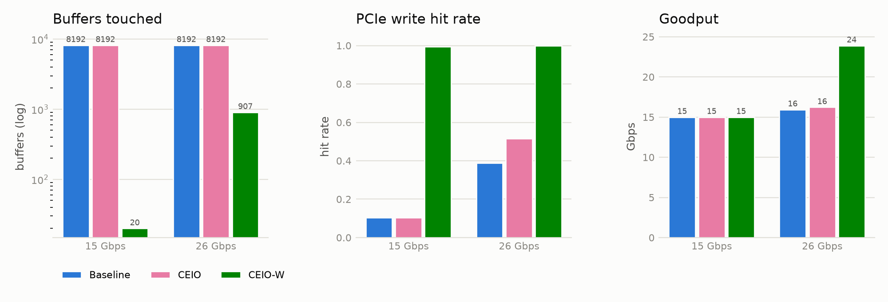

# Generated results

Made by `python -m ceiosim`, so please don't edit it by hand. The discussion of these numbers is in docs/results.md.

## Toasty Fig. 7 and 18: saturation throughput (at most 0.1 % loss)

### Toasty Fig. 7: saturation throughput, PCIe write hits and DRAM writes

| App | Config | Gbps | PCIe write hit | Dead writebacks | DRAM writes GB/s | Buffers touched |
|---|---|---|---|---|---|---|
| nat | Default (16384 FIFO) | 43.4 | 0.12 | 31547 | 5.71 | 16384 |
| nat | Pool sized to DDIO (4096) | 50.4 | 0.25 | 8260 | 5.31 | 4096 |
| nat | Toasty | 52.7 | 0.22 | 425 | 5.80 | 6263 |
| l2fwd | Default (16384 FIFO) | 77.0 | 0.10 | 300095 | 9.76 | 16384 |
| l2fwd | Pool sized to DDIO (4096) | 77.3 | 0.12 | 293105 | 9.55 | 4096 |
| l2fwd | Toasty | 77.7 | 0.90 | 20659 | 1.02 | 621 |
| ids | Default (16384 FIFO) | 28.1 | 0.10 | 109772 | 3.57 | 16384 |
| ids | Pool sized to DDIO (4096) | 28.1 | 0.12 | 106721 | 3.47 | 4096 |
| ids | Toasty | 28.5 | 1.00 | 6 | 0.00 | 90 |

### Toasty Fig. 18: Toasty's two parts (NAT, saturation Gbps)

| Toasty, full | LIFO pool only | Adaptive refill only | Default |
|---|---|---|---|
| 52.7 | 49.6 | 43.8 | 43.4 |

## Toasty Table 7: drops during bursts

### Toasty Table 7: drops during bursts of 2048 packets (NAT)

| Default (16384) | Small pool (512) | Toasty (16384) |
|---|---|---|
| 0.00 % | 29.61 % | 0.00 % |

## CEIO Fig. 4a and 10a: dynamic flows

### Dynamic flow distribution: 8 KV → 6 KV + 2 LineFS → 4 KV + 4 LineFS

| Scheme | Phase 0 | Phase 1 | Phase 2 | P99.9 µs | NIC drops | Reordered |
|---|---|---|---|---|---|---|
| Baseline | 30.6 | 22.1 | 12.7 | 509.6 | 4187 | 0 |
| HostCC | 23.4 | 15.2 | 10.3 | 509.6 | 1241 | 0 |
| ShRing | 35.0 | 41.0 | 28.2 | 265.3 | 771 | 153559 |
| Toasty | 30.7 | 31.1 | 23.1 | 2147.5 | 1062 | 0 |
| CEIO | 16.4 | 21.6 | 12.4 | 1132.5 | 0 | 0 |
| CEIO-W | 29.3 | 19.4 | 17.5 | 283.1 | 0 | 0 |

## CEIO Fig. 4b and 10b: bursts

### Network burst: 8 KV, + 2 burst KV flows in phases 1 and 3

| Scheme | Phase 0 | Phase 1 | Phase 2 | Phase 3 | P99.9 µs | NIC drops | Reordered |
|---|---|---|---|---|---|---|---|
| Baseline | 32.0 | 35.1 | 34.6 | 35.3 | 530.6 | 2572 | 0 |
| HostCC | 23.2 | 21.7 | 35.4 | 22.7 | 534.8 | 961 | 0 |
| ShRing | 35.4 | 34.6 | 38.6 | 34.4 | 2298.5 | 2393 | 153009 |
| Toasty | 30.7 | 38.5 | 37.9 | 38.5 | 2160.7 | 1217 | 0 |
| CEIO | 16.5 | 25.0 | 29.2 | 20.6 | 1166.0 | 0 | 0 |
| CEIO-W | 29.3 | 26.1 | 37.9 | 22.7 | 438.3 | 0 | 0 |

## CEIO Table 4: mixed flows

### CEIO Table 4: KV Mpps / LineFS Gbps / P99.9 µs

| CPU : bypass | Baseline | HostCC | ShRing | Toasty | CEIO | CEIO-W |
|---|---|---|---|---|---|---|
| 6 : 2 | 25.3 / 46 / 80 | 13.3 / 49 / 44 | 26.9 / 49 / 359 | 23.7 / 49 / 2147 | 21.4 / 49 / 192 | 22.3 / 50 / 275 |
| 4 : 4 | 16.5 / 96 / 126 | 10.1 / 100 / 44 | 16.5 / 100 / 533 | 16.9 / 100 / 2122 | 14.6 / 100 / 298 | 14.3 / 100 / 298 |
| 2 : 6 | 7.1 / 141 / 466 | 8.4 / 150 / 69 | 8.0 / 149 / 1107 | 8.2 / 150 / 85 | 8.1 / 149 / 280 | 10.5 / 149 / 136 |

## 8 KV flows with and without a 100 GB/s memory co-runner

### Memory pressure: KV Mpps (P99.9 µs)

| Co-runner | Baseline | HostCC | ShRing | Toasty | CEIO | CEIO-W |
|---|---|---|---|---|---|---|
| none | 35.9 (189) | 34.7 (6) | 36.5 (256) | 31.5 (2137) | 25.5 (306) | 30.3 (315) |
| 100 GB/s | 2.8 (3255) | 5.4 (10) | 12.0 (696) | 18.1 (1124) | 2.8 (11226) | 25.3 (94) |

## Cache footprint (one KV core, 4096 ring, no CC)

### Cache footprint

| Load | Scheme | Goodput Gbps | KV hit | PCIe write hit | Dead writebacks | DRAM writes GB/s | Buffers touched | P99.9 µs |
|---|---|---|---|---|---|---|---|---|
| 15 Gbps | Baseline | 15.0 | 1.00 | 0.10 | 56456 | 1.85 | 8192 | 1.26 |
| 15 Gbps | CEIO | 15.0 | 1.00 | 0.10 | 56456 | 1.85 | 8192 | 1.26 |
| 15 Gbps | CEIO-W | 15.0 | 1.00 | 0.99 | 0 | 0 | 20 | 1.25 |
| 26 Gbps | Baseline | 15.9 | 0.29 | 0.39 | 15631 | 2.82 | 8192 | 1110.2 |
| 26 Gbps | CEIO | 16.2 | 0.46 | 0.52 | 14230 | 1.82 | 8192 | 1088.6 |
| 26 Gbps | CEIO-W | 23.9 | 1.00 | 1.00 | 1 | 0.00 | 907 | 368.3 |

## CEIO-W ablation

### CEIO-W ablation

| Variant | Overload Gbps | Dynamic KV Mpps | Dynamic dead writebacks | Pressure KV Mpps | Pressure P99.9 µs |
|---|---|---|---|---|---|
| CEIO | 16.2 | 16.6 | 454901 | 2.81 | 11225.5 |
| CEIO + warm buffers only | 16.5 | 21.6 | 321211 | 13.1 | 931.1 |
| CEIO-W (all mechanisms) | 23.9 | 22.1 | 24981 | 25.3 | 93.8 |
| CEIO-W, equal split instead of adaptive allocation | 21.1 | 22.9 | 51989 | 24.6 | 91.8 |
| CEIO-W, fixed budget | 23.9 | 21.5 | 21620 | 22.1 | 392.2 |
| CEIO-W, static Eq. (1) budget | 23.9 | 21.1 | 28735 | 21.6 | 392.2 |

## Flow churn ([CEIO] Fig. 12)

### Flow churn: slow-path share % / P99 µs (16 active flows, 60 Gbps)

| Flows | Slot | Baseline | CEIO | CEIO (idle timer = slot) | CEIO-W |
|---|---|---|---|---|---|
| 16 | 100 µs | 0 % / 1.4 | 0 % / 1.4 | 0 % / 1.4 | 0 % / 1.4 |
| 128 | 100 µs | 0 % / 1.4 | 0 % / 1.4 | 81 % / 2.6 | 0 % / 1.4 |
| 512 | 100 µs | 0 % / 1.5 | 0 % / 1.5 | 95 % / 2.7 | 0 % / 1.5 |
| 1024 | 100 µs | 0 % / 1.5 | 0 % / 1.5 | 97 % / 2.6 | 0 % / 1.4 |
| 2048 | 100 µs | 0 % / 1.5 | 19 % / 2.5 | 98 % / 2.7 | 0 % / 1.5 |
| 16 | 1000 µs | 0 % / 1.4 | 0 % / 1.4 | 0 % / 1.4 | 0 % / 1.4 |
| 128 | 1000 µs | 0 % / 1.5 | 0 % / 1.5 | 8 % / 2.4 | 0 % / 1.5 |
| 512 | 1000 µs | 0 % / 1.5 | 0 % / 1.5 | 10 % / 2.5 | 0 % / 1.5 |
| 1024 | 1000 µs | 0 % / 1.5 | 0 % / 1.5 | 8 % / 2.5 | 0 % / 1.5 |
| 2048 | 1000 µs | 0 % / 1.4 | 28 % / 3.4 | 13 % / 2.5 | 0 % / 1.4 |

![Flow churn ([CEIO] Fig. 12)](../figures/flow_churn.png)

## Different seeds

### Different seeds: KV Mpps mean (lowest to highest)

Seeds: 1, 2, 3, 4, 5.

| Case | Toasty | CEIO | CEIO-W |
|---|---|---|---|
| pressure | 18.6 (17.8 to 19.4) | 2.8 (2.8 to 2.8) | 25.2 (25.1 to 25.3) |
| dynamic | 28.2 (28.1 to 28.2) | 17.1 (16.6 to 17.6) | 22.2 (22.0 to 22.6) |
